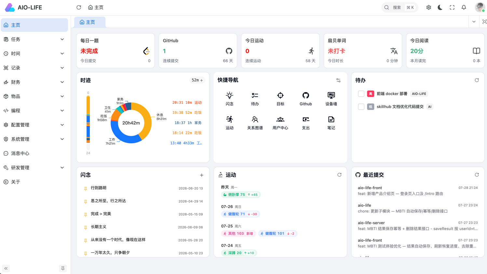
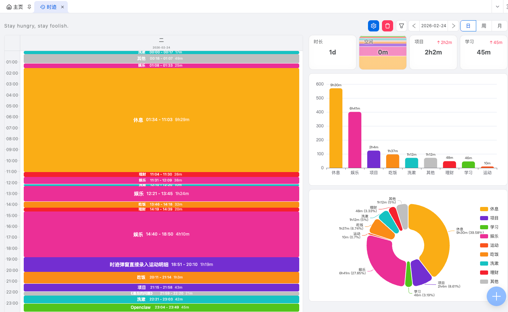

# AIO Life Web

AIO Life 的 Web 客户端，用于记录、查看和管理个人生活数据。基于 Vue Vben Admin 5.5.9，使用 Vue 3、TypeScript、Vite、Ant Design Vue、Pinia 和 ECharts，采用 pnpm + Turborepo monorepo。

[站点入口](https://aiolife.top) · [项目总览](https://github.com/lys1313013/aio-life) · [后端](https://github.com/lys1313013/aio-life-server) · [移动端](https://github.com/lys1313013/aio-life-mobile) · [Web 文档](docs/README.md)

项目仍在开发中；可见功能由账号权限、菜单配置和二级锁决定，第三方同步需另行绑定账号或配置服务。

## 功能概览

| 领域 | 主要功能 |
| --- | --- |
| 首页 | 可配置卡片、今日时迹、每日统计、关注待办、固定闪念、快捷导航与近期记录 |
| 时间与任务 | 时迹录入和统计、时间分类、待办、长期目标 |
| 生活记录 | 运动、身体数据、生活足迹、阅读、微信读书、视频观看、活动、笔记、闪念、里程碑、纪念日与荣誉 |
| 财务与物品 | 收支统计、银行卡、账单导入、设备、衣柜与会员记录 |
| 连接与工具 | 人际关系图谱、GitHub／LeetCode／CSDN 看板、密码库、MCP 工具调试 |
| 个人与系统 | 账号与第三方绑定、消息通知、用户与菜单、字典、对象存储、定时任务、操作／访问日志及反馈管理 |

功能范围和跨端规则集中维护在[主项目文档目录](https://github.com/lys1313013/aio-life/blob/main/docs/README.md)。首页交互见[首页功能说明](https://github.com/lys1313013/aio-life/blob/main/docs/首页功能说明.md)，不要用截图或旧验收记录判断当前功能是否完成。

## 快速开始

### 环境

- Node.js：使用与 [CI](.github/workflows/docker.yml) 一致的 `22.23.4`。根 `package.json` 的 `engines` 下限不能替代 Vite 等工具的实际要求。
- pnpm：使用 `package.json#packageManager` 固定的 `10.22.0`。
- 后端：先按[后端 README](https://github.com/lys1313013/aio-life-server/blob/main/README.md)准备数据库、Redis 和环境变量，启动业务 API。Web 不会自动启动后端，也不提供可替代真实业务服务的 mock 应用。

首次获取代码后，在本仓库根目录安装依赖并启动：

```bash
git clone https://github.com/lys1313013/aio-life-front.git
cd aio-life-front
corepack enable
pnpm install --frozen-lockfile
pnpm run dev:antd
```

开发页默认使用 `http://localhost:5666`，实际地址以启动日志为准。请求 `/api` 由 [Vite 配置](apps/web-antd/vite.config.mts)代理到 `http://localhost:45678/api`；需要连接其他后端时调整该代理目标。

### 配置

环境文件位于 `apps/web-antd/`，个人覆盖配置写入 `.env.development.local` 或 `.env.production.local`，修改后重启开发服务或重新构建。

| 配置 | 用途 |
| --- | --- |
| `VITE_PORT` | 开发端口，当前为 `5666` |
| `VITE_GLOB_API_URL` | API 基址，开发和生产默认均为 `/api` |
| `VITE_BASE` | 应用部署路径，默认为 `/` |
| `VITE_APP_TITLE` / `VITE_APP_NAMESPACE` | 页面标题和本地缓存命名空间 |
| `VITE_ROUTER_HISTORY` | 路由模式，生产配置为 `hash` |
| `VITE_PWA` | PWA 开关，生产配置默认关闭 |

`VITE_*` 配置会暴露给浏览器，不能放入数据库密码、服务端密钥或访问 Token；`VITE_APP_STORE_SECURE_KEY` 也不是服务端保密凭据。保持同源 `/api` 时，由开发代理或部署反向代理连接业务服务。

## 开发与验证

以下命令均在本仓库根目录执行，按改动范围选择：

| 命令 | 用途 |
| --- | --- |
| `pnpm run dev:antd` | 启动主应用 |
| `pnpm run build:antd` | 构建主应用，产物在 `apps/web-antd/dist/` |
| `pnpm --filter @vben/web-antd typecheck` | 检查应用类型 |
| `pnpm run check:type` | 检查整个工作区类型 |
| `pnpm run test:unit` | 执行 Vitest 单元测试并退出 |
| `pnpm run test:critical` | CI 使用的关键路径回归 |
| `pnpm run lint` | 代码与样式检查 |
| `pnpm run check` | 循环依赖、依赖、类型及拼写检查 |
| `pnpm run icons:check` | 检查本地图标生成资源是否同步 |

运行单个测试：

```bash
pnpm exec vitest run apps/web-antd/src/api/payload.test.ts --dom
```

`pnpm run dev` 提供交互式应用选择，`pnpm run build` 构建工作区任务。当前业务应用是 `apps/web-antd`；`package.json` 中部分其他 UI 变体和示例命令来自上游模板，不是本项目的启动入口。移动端已迁入独立仓库，不参与此工作区安装与检查。

开发前阅读 [AGENTS.md](AGENTS.md)，其中维护请求响应、字符串 ID、附件鉴权、路由权限、弹窗和响应式布局约定。UI 改动需检查手机、平板、桌面及深浅主题；纯文档修改只检查差异和引用。跨端请求 DTO 变更及统一推送流程见[API 参数规范](https://github.com/lys1313013/aio-life/blob/main/docs/API参数规范.md)。

## 构建与部署

```bash
pnpm run build:antd
```

将 `apps/web-antd/dist/` 部署到静态服务器，并配置 `/api` 反向代理。Vite 的开发代理不随构建产物部署；仅上传静态文件不会启动业务 API。

现行镜像流水线见 [.github/workflows/docker.yml](.github/workflows/docker.yml)：先检查应用类型、运行关键测试并构建，再通过 [Dockerfile.runtime](scripts/deploy/Dockerfile.runtime)打包静态产物。镜像监听 `8080`，[Nginx 配置](scripts/deploy/nginx.conf)默认将 `/api` 转发到 `backend:45678`，部署时需提供对应网络和服务名。旧 `build:docker` 入口仍引用上游 `playground/dist`，不适用于当前应用。

构建或镜像推送成功只说明产物已生成；目标环境的 API、登录和业务流程仍需部署后验证。

## 目录与文档

```text
aio-life-front/
├── apps/web-antd/       # Web 主应用，# 别名指向 src/
│   └── src/
│       ├── api/         # 请求客户端、业务 API 与契约
│       ├── components/  # 应用公共组件
│       ├── router/      # 路由与权限
│       ├── store/       # 应用状态
│       └── views/       # 业务页面
├── packages/            # 共享框架、组件、图标、样式与工具
├── internal/            # Vite、TypeScript 与 lint 配置
├── scripts/             # 工作区命令、图标生成与部署文件
└── docs/                # Web 实现说明与历史变更
```

- [Web 文档目录](docs/README.md)：图片鉴权、密码库、首页设计和工作区工具。
- [应用弹窗](apps/web-antd/src/components/app-modal/README.md)：公共表单与弹窗用法。
- [图标本地化](scripts/icons/README.md)、[图标包](packages/icons/README.md)：资源生成、校验与跨端同步。
- [跨端文档目录](https://github.com/lys1313013/aio-life/blob/main/docs/README.md)：业务需求、API 契约、部署和历史验收。

## 界面预览

以下为仓库保留的界面截图，实际布局以当前代码为准。

| 首页 | 时迹 | 设备墙 |
| --- | --- | --- |
|  |  |  |

## 使用与贡献

使用者必须在网站标注作者名称以及指向本项目的链接。如果不想保留署名，必须首先获得授权。不得用于非法用途，请勿商用和二次售卖。

提交贡献前阅读开发规范，在 PR 中说明解决的问题、变更范围、实际验证及未验证项。各客户端和服务是独立仓库，请将改动提交到所属仓库，不提交凭据或本地运行产物。
